# Praktikum 6: JavaScript DOM dan Event Handling

## Identitas Mahasiswa
- **Nama:** Amelia Futri
- **NIM:** 312510348
- **Program Studi:** Teknik Informatika
- **Mata Kuliah:** Pemrograman Web
- **Repository:** Lab6Web

## Deskripsi Praktikum
Praktikum ini membahas penggunaan Document Object Model (DOM) dan event handling pada JavaScript. Melalui latihan dan mini project, mahasiswa mempelajari cara memilih serta mengubah elemen HTML, menangani tindakan pengguna, membuat validasi form, dan membangun halaman web yang interaktif.

## Tujuan
1. Memahami DOM sebagai representasi dokumen HTML yang dapat diakses melalui JavaScript.
2. Memilih elemen HTML menggunakan ID dan selector CSS.
3. Mengubah teks, class, dan tampilan elemen menggunakan JavaScript.
4. Menangani event pengguna menggunakan `addEventListener()`.
5. Membuat validasi form dan menampilkan pesan sesuai kondisi input.
6. Membuat halaman web interaktif dengan beberapa fungsi yang berjalan dengan baik.

## Struktur Repository
```text
Lab6Web/
├── index.html
├── style.css
├── script.js
├── README.md
├── Laporan_Praktikum_6.docx
└── screenshots/
    ├── latihan-1.png
    ├── latihan-2.png
    ├── latihan-3.png
    ├── latihan-4.png
    ├── latihan-5.png
    ├── latihan-6.png
    ├── mini-project-valid.png
    ├── mini-project-tidak-valid.png
    └── eksperimen-mandiri.png
```

## Cara Menjalankan
1. Pastikan file `index.html`, `style.css`, dan `script.js` berada dalam folder yang sama.
2. Buka folder proyek di Visual Studio Code.
3. Buka `index.html` menggunakan browser atau ekstensi Live Server.
4. Coba fitur-fitur pada halaman dan periksa hasilnya.
5. Jika ada masalah, periksa Console pada Developer Tools browser.

## Langkah Kerja dan Hasil

### Latihan 1 — Mengubah Teks dengan DOM
Elemen HTML dipilih menggunakan `document.getElementById()`, lalu teksnya diubah melalui `textContent`. Hasilnya, judul dan paragraf dapat diperbarui menggunakan JavaScript.


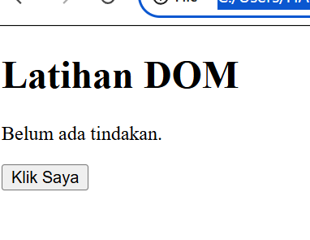
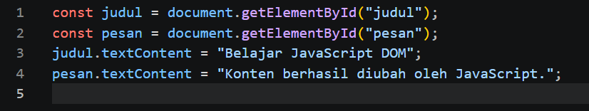
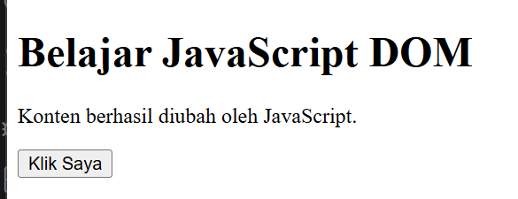

### Latihan 2 — Event Click
`addEventListener("click", ...)` digunakan agar ketika tombol diklik, teks pada halaman berubah dan waktu tindakan ditampilkan.

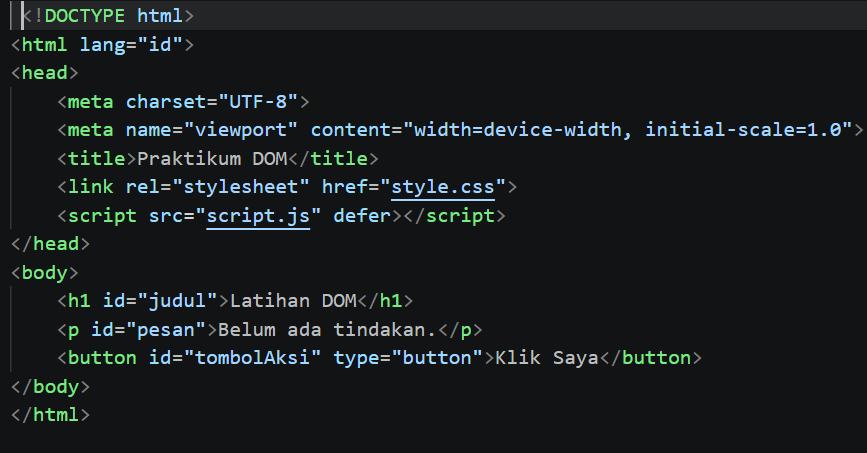
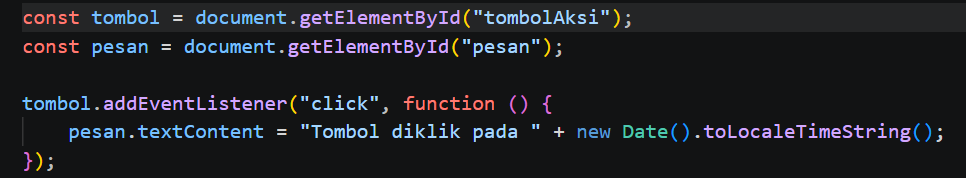
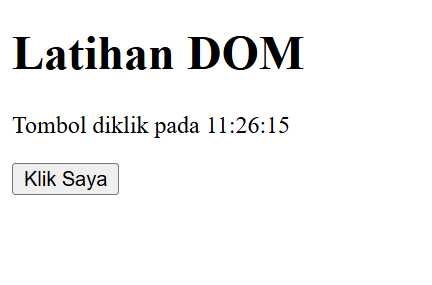

### Latihan 3 — Mengubah Class dan Gaya CSS
`classList.toggle()` digunakan untuk menambahkan atau menghapus class CSS. Hasilnya, tampilan elemen dapat berubah saat tombol diklik.

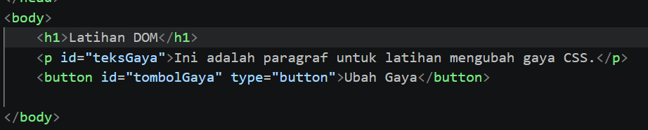
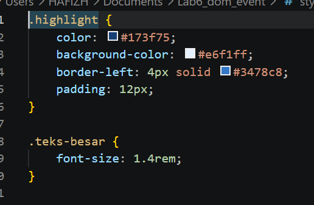
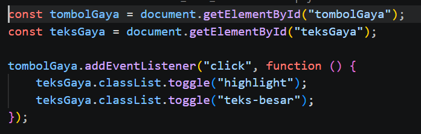
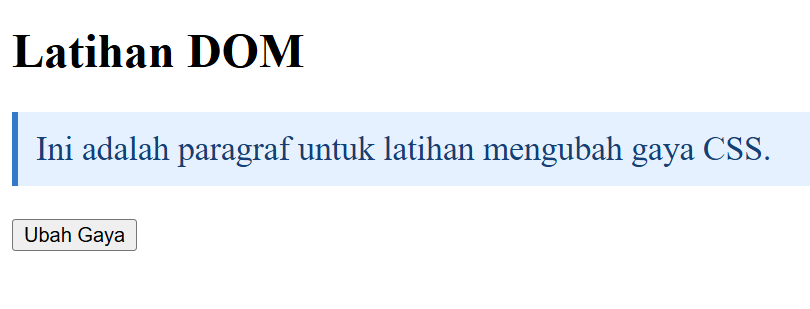

### Latihan 4 — Event Input dan Penghitung Karakter
Event `input` digunakan untuk memperbarui jumlah karakter sesuai teks yang diketik, dihapus, atau ditempelkan pengguna.

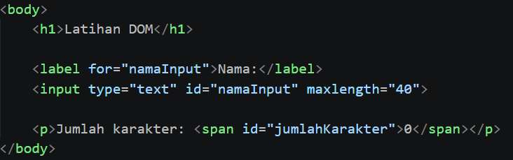


### Latihan 5 — Validasi Form Pendaftaran
Form memeriksa nama, format email, dan usia. `event.preventDefault()` mencegah pengiriman form secara langsung agar validasi dapat dilakukan terlebih dahulu.

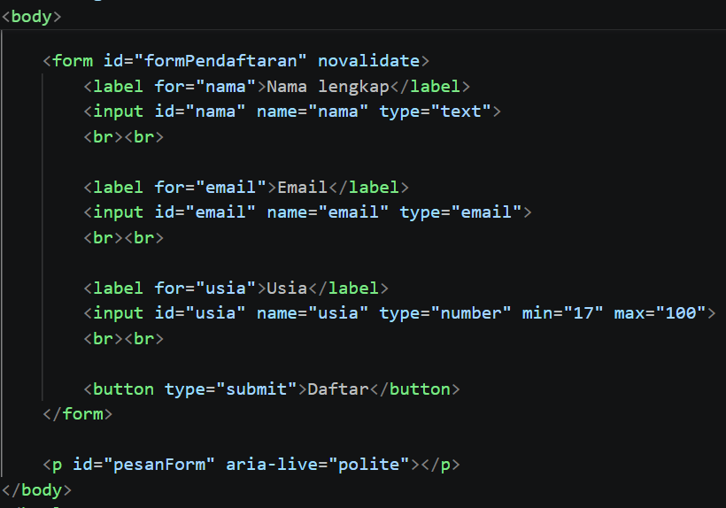

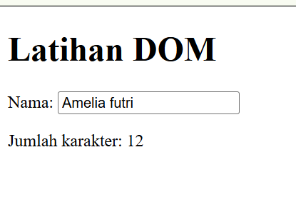

### Latihan 6 — To-do List
Pengguna dapat menambahkan tugas dan menandai tugas sebagai selesai. Tugas yang selesai ditampilkan dengan gaya berbeda.

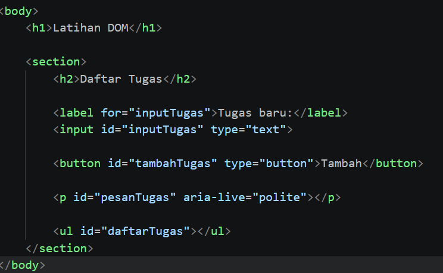
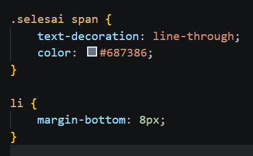
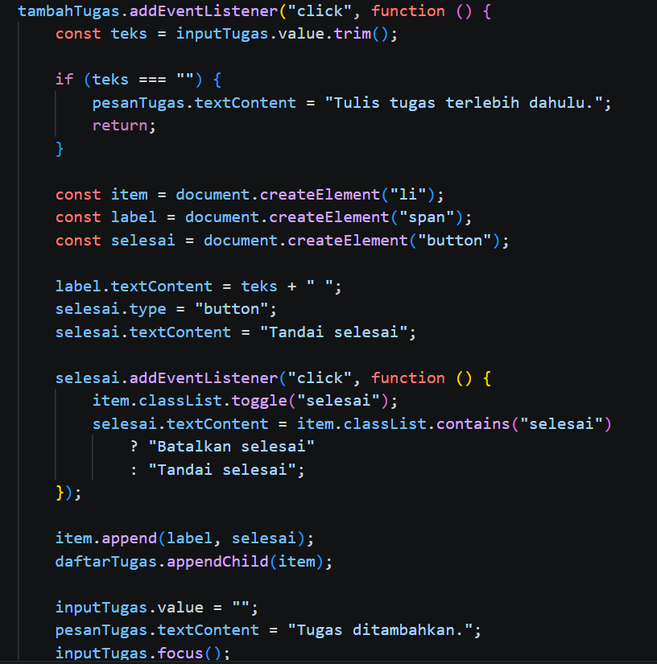
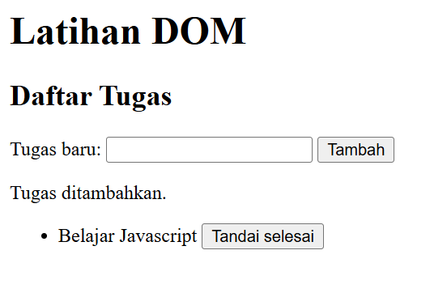
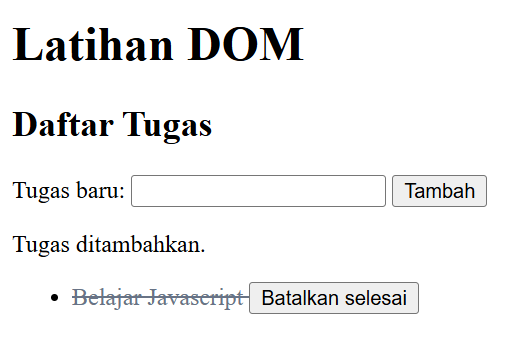

### Mini Project — Form Pendaftaran Workshop
Mini project menyediakan validasi nama, email, dan pilihan sesi, penghitung karakter atau ringkasan input, pesan kesalahan dan sukses, serta fungsi reset sesuai implementasi proyek.

**Kondisi input valid**

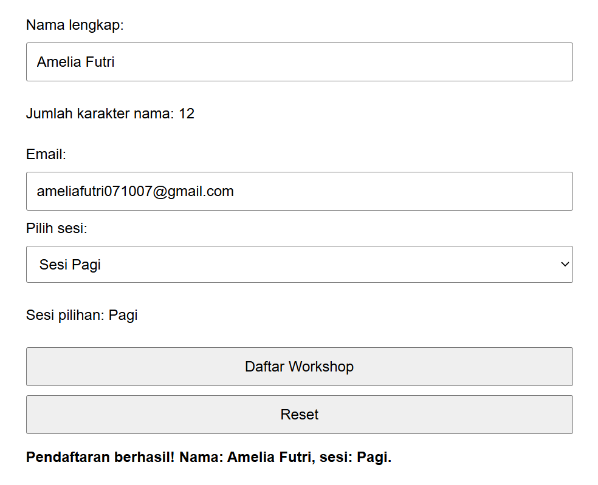

**Kondisi input tidak valid**

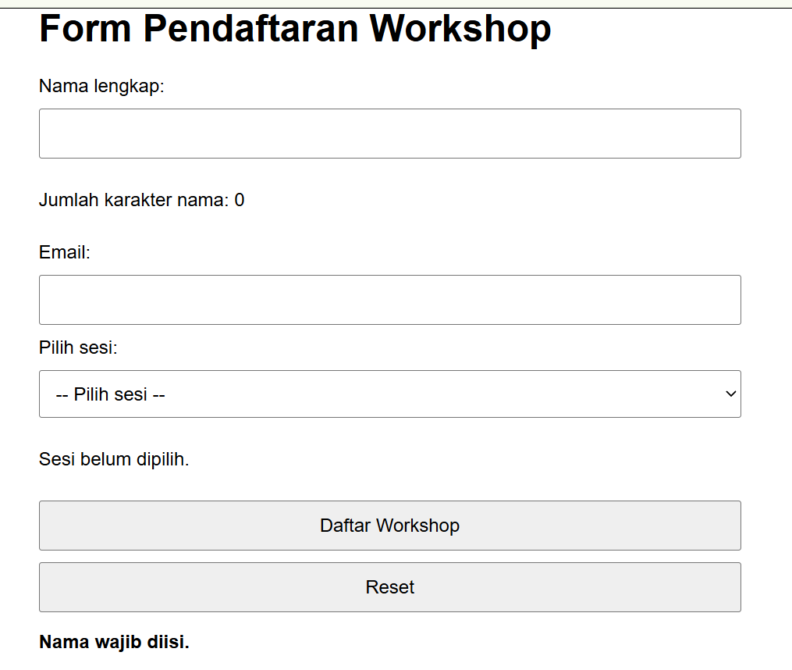

## Eksperimen Mandiri

1. **Menghapus item To-do List:** setiap item memiliki tombol Hapus untuk menghilangkan tugas yang dipilih.
2. **Validasi nama minimal tiga karakter:** sistem menolak nama kosong dan nama yang kurang dari tiga karakter.
3. **Event change pada sesi workshop:** ringkasan menampilkan sesi yang dipilih pengguna.
4. **Tombol tampil/sembunyi:** `classList.toggle()` digunakan untuk menyembunyikan dan menampilkan paragraf dengan class CSS.
5. **Menguji script tanpa `defer`:** script di bagian `<head>` dapat dijalankan sebelum HTML selesai diparsing. Akibatnya, elemen yang dicari JavaScript mungkin belum tersedia. Setelah pengamatan, atribut `defer` dikembalikan.

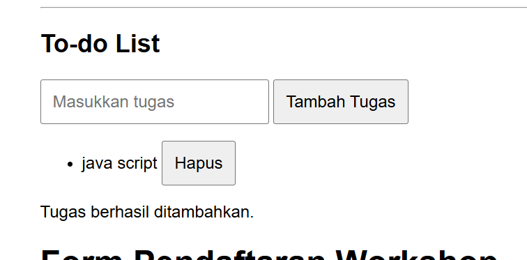
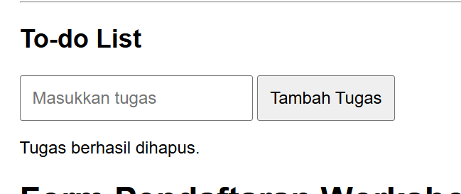

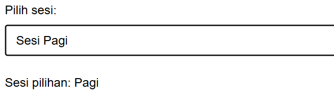
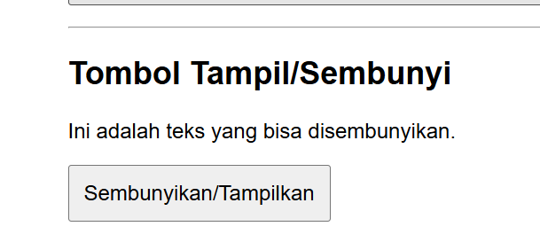
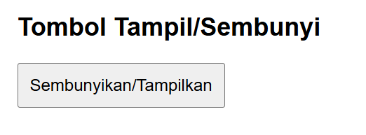
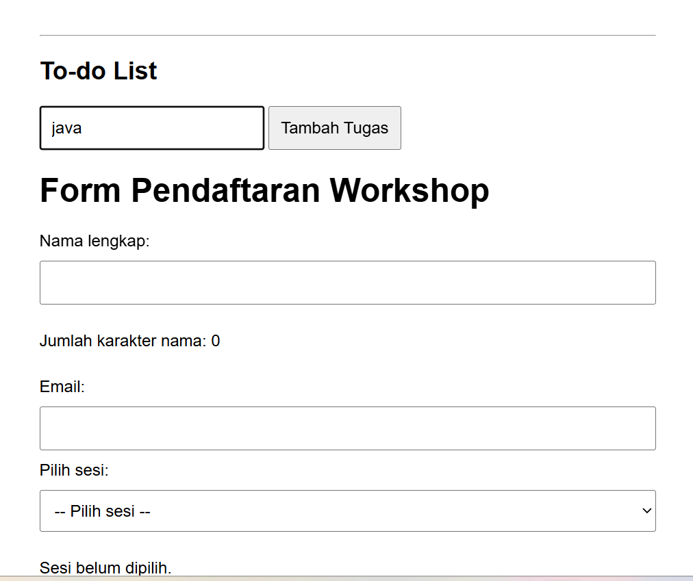


## Pertanyaan Evaluasi

### 1. Apa yang dimaksud dengan DOM dan apa manfaatnya?
DOM (*Document Object Model*) adalah representasi struktur HTML dalam bentuk objek yang dapat diakses oleh JavaScript. DOM bermanfaat untuk memilih elemen, mengubah konten, mengatur class CSS, menambah atau menghapus elemen, dan merespons tindakan pengguna.

### 2. Apa perbedaan `getElementById()`, `querySelector()`, dan `querySelectorAll()`?
- `getElementById()` memilih elemen berdasarkan ID.
- `querySelector()` memilih elemen pertama yang cocok dengan selector CSS.
- `querySelectorAll()` memilih semua elemen yang cocok dengan selector CSS.

### 3. Apa fungsi `addEventListener()` dan sebutkan tiga contoh event?
`addEventListener()` menghubungkan suatu event dengan fungsi yang dijalankan ketika event terjadi. Contohnya `click` saat elemen diklik, `input` saat isi input berubah, dan `submit` saat form dikirim.

### 4. Mengapa `event.preventDefault()` digunakan pada event submit form?
Fungsi ini mencegah perilaku bawaan browser, seperti pengiriman form yang membuat halaman dimuat ulang, sehingga JavaScript dapat memeriksa input dan menampilkan pesan validasi terlebih dahulu.

### 5. Apa perbedaan `textContent` dan `innerHTML` dari sisi penggunaan dan keamanan?
`textContent` digunakan untuk membaca atau mengubah teks biasa. `innerHTML` digunakan untuk membaca atau mengubah isi elemen dalam bentuk markup HTML. `textContent` lebih aman untuk menampilkan teks dari pengguna karena teks tersebut tidak diproses sebagai markup HTML.

### 6. Bagaimana `classList.toggle()` membantu mengubah tampilan elemen?
`classList.toggle()` menambahkan class jika belum ada dan menghapusnya jika sudah ada. Fungsi ini dapat dipakai untuk mengubah tampilan elemen secara bergantian, misalnya menyembunyikan dan menampilkan paragraf.

### 7. Sebutkan minimal tiga skenario pengujian validasi form.
1. Semua kolom dikosongkan: sistem menampilkan pesan bahwa nama wajib diisi.
2. Email tidak sesuai format: sistem meminta pengguna memasukkan email yang valid.
3. Semua input diisi dengan benar: sistem menampilkan pesan validasi berhasil.
4. Pengujian tambahan: usia di bawah 17 atau di atas 100 ditolak sesuai aturan form.

## Kesimpulan
Praktikum ini membantu memahami cara JavaScript berinteraksi dengan elemen HTML melalui DOM, menangani event pengguna, mengubah tampilan halaman, dan memvalidasi input form. Pengujian berbagai kondisi diperlukan untuk memastikan fitur berjalan sesuai harapan.

## Referensi
1. Modul Praktikum Pemrograman Web, Praktikum 6: JavaScript DOM dan Event Handling.
2. MDN Web Docs — Introduction to the DOM: https://developer.mozilla.org/en-US/docs/Web/API/Document_Object_Model/Introduction
3. MDN Web Docs — Event reference: https://developer.mozilla.org/en-US/docs/Web/Events
4. MDN Web Docs — Client-side form validation: https://developer.mozilla.org/en-US/docs/Learn/Forms/Form_validation
